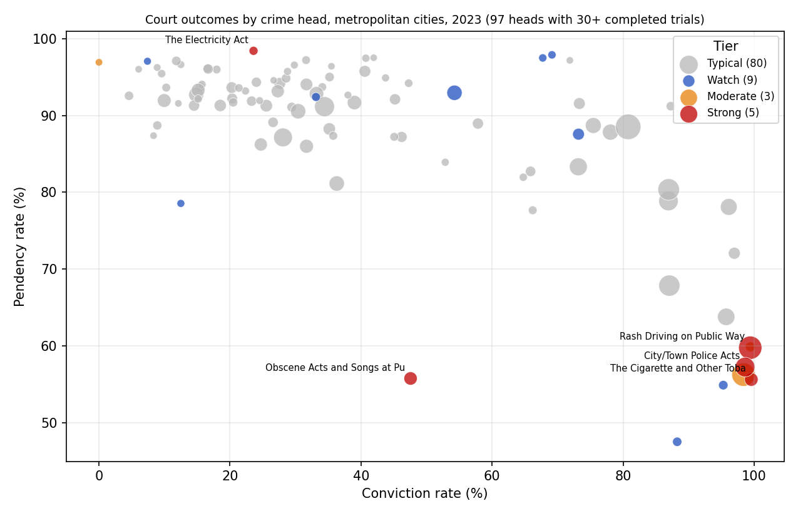

# TrialTrace: explainable anomaly analysis of court outcomes (NCRB 2023)

Which crime heads show unusual court outcomes in India's 19 metropolitan cities, and how sure can we be?
TrialTrace parses NCRB's court-disposal tables, attaches confidence intervals to every rate, flags outliers with
three methods, explains each flag in plain English and tests how stable it is.



## Data
NCRB *Crime in India 2023*, court disposal of crimes by crime head, metropolitan cities (aggregate):
Table 18B.1 (IPC) and Table 18B.3 (SLL). PDFs are in `data/raw/`. 188 detail-level crime heads were parsed.

## Method
1. **Parse and validate** (`parse.py`, `validate.py`): PDFs become one table; parents, subtotals and grand totals are tagged
   so nothing is double counted. Every row is checked against NCRB's printed formulas, published rates are recomputed, and
   parents are compared with the sum of their children. Result: 0 failures.
2. **Features** (`features.py`): conviction rate, discharge share, pendency rate and share of cases ended without trial, each
   with a Wilson 95% interval. Heads with fewer than 30 completed trials (91 of 188) are marked *insufficient data* and never flagged.
3. **Detection** (`detect.py`): robust z-score (median/MAD on logit rates, |z| >= 3.5) as the main method; Isolation Forest
   (500 trees) and Local Outlier Factor as comparisons; sensitivity at 5%, 10% and 15% contamination.
4. **Explanation and stability** (`explain.py`, `stability.py`): each flag gets a sentence naming its main drivers against the
   peer median. Outcome counts are re-drawn 100 times from the observed proportions and all detectors re-run; a head is
   **Strong** when at least two methods flag it, it survives >= 80% of re-draws and its interval clears the peer median.
5. **Dashboard** (`app.py`): Streamlit app with overview map, flagged table, per-head explorer, method comparison,
   data-quality checks and limitations.

## Results (2023, metropolitan cities)
- 97 heads analysed: **5 Strong, 3 Moderate, 9 Watch, 80 Typical**.
- The typical head has a conviction rate near 33%, pendency near 92% and about 6% of cases ended without trial.
- Strong flags: Rash Driving on Public Way, Cigarette and Other Tobacco Products Act, City/Town Police Acts (all about 99% conviction
  with pendency in the mid-50s), Obscene Acts and Songs at Public Places (65% of cases ended without trial) and the Electricity Act
  (98% pendency, almost no cases ended without trial).
- The three methods only partly agree: 8 heads are flagged by two methods and none by all three, and LOF shares no flags with the
  robust z-score. Treat single-method flags as leads, not findings.
- Most Strong flags are high-volume regulatory offences processed in bulk, so they stand out partly by construction.

## Limitations
Flags are statistical signals, not findings of wrongdoing. One year, aggregated metropolitan data only; no state or city
comparison and no trends. Case mix and reporting practices differ between crime heads and courts. Thresholds (|z| >= 3.5,
10% contamination, 30-trial minimum) are conventional defaults, shown with a sensitivity check, not tuned.

## Run it
```
pip install -r requirements.txt
python scripts/run_all.py        # phases 1-4 and the figure
pytest                           # 15 tests
streamlit run app.py
```

## Deploy (Streamlit Community Cloud)
Push the repo to GitHub (keep `data/processed/` committed), go to share.streamlit.io, choose the repo, set the main file to
`app.py`, and deploy. Add the live link at the top of this README.

## Layout
```
app.py                  dashboard
src/nyayalens/          parse, validate, features, detect, explain, stability
scripts/                run_phase1..4, run_all, make_figure
data/raw/               source PDFs
data/processed/         clean table, features, detections, final results, validation reports
docs/                   plan, data dictionary, figures
tests/                  15 tests
```
